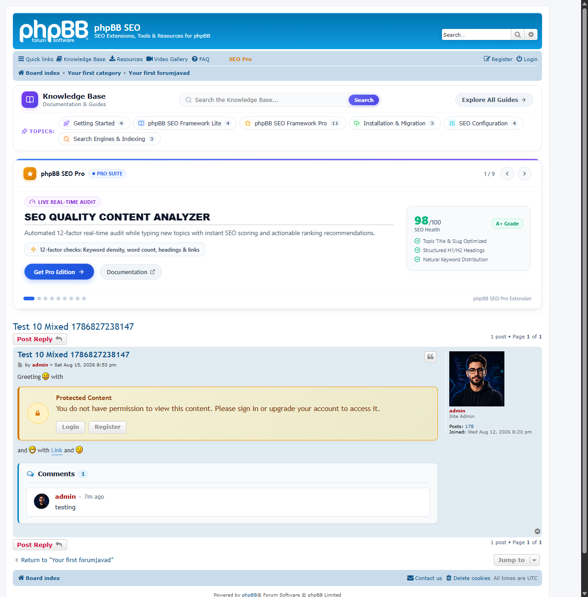
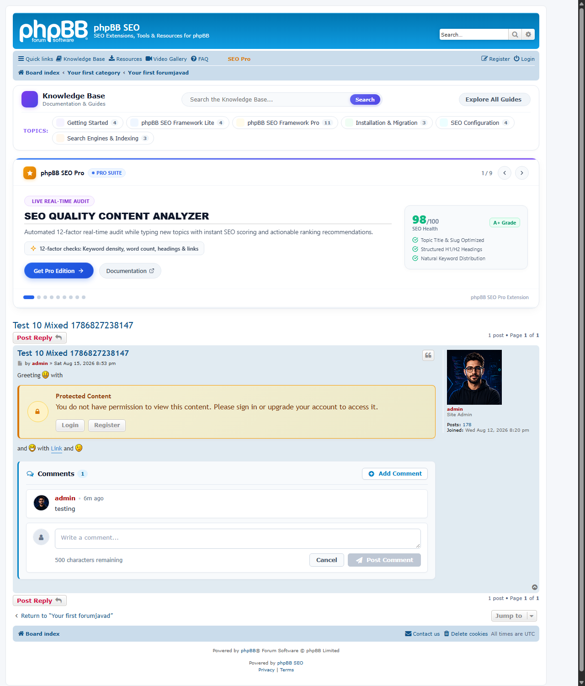
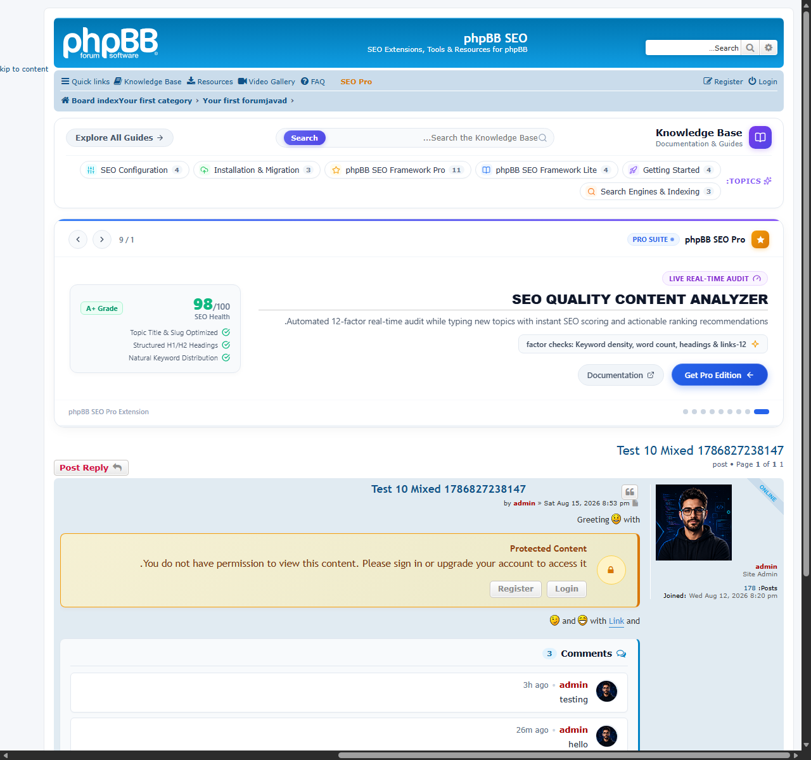
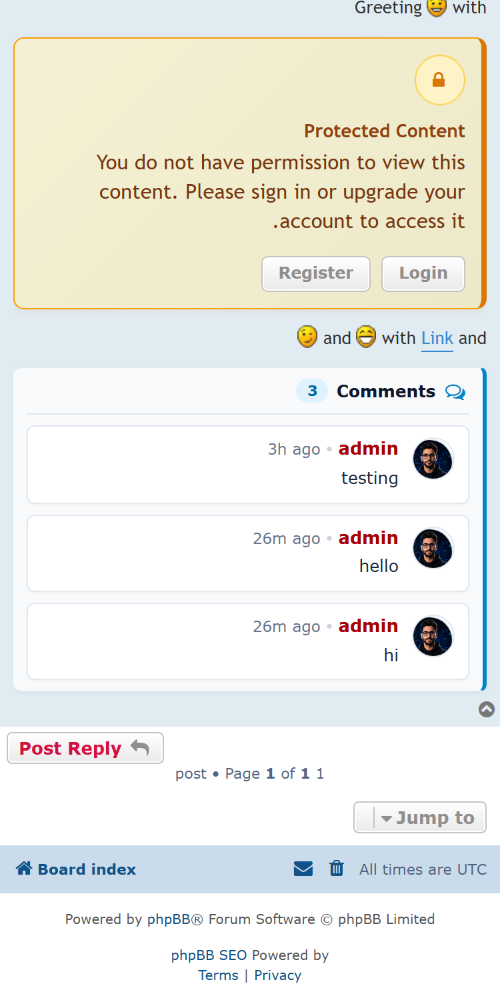

# phpBB Post Comments Extension

[](https://www.phpbb.com/)
[](https://php.net/)
[](LICENSE)
[](https://github.com/phpbb-seo/phpbb-post-comments/releases)

A modern, nested AJAX comment engine for **phpBB 3.3.x** posts inspired by vBulletin 6 sub-panel design. It allows forum members to discuss and respond directly to individual posts within a topic without cluttering the main thread.

---

## ✨ Features

- **Nested Sub-Panel Design:** Modern card layout (`#f8fafc` background, subtle `#e2e8f0` border, `#0284c7` indicator bar, and clean circular 36px avatars).
- **Pure AJAX Powered:** Post, edit, delete, and paginated loading ("View earlier comments") occur seamlessly in real time without refreshing the page.
- **Smart Toggle & Auto-Close:** The comment form cleanly slides down on click, toggles closed with "+ Add Comment" or "Cancel", and automatically collapses after successful submission.
- **Instant Keyboard Shortcuts:** Press <kbd>Ctrl</kbd> + <kbd>Enter</kbd> (or <kbd>Cmd</kbd> + <kbd>Enter</kbd> on macOS) to instantly submit comments or save inline edits.
- **Live Character Counter:** Real-time character limit enforcement and dynamic warning indicator when approaching the configurable limit.
- **Native Notifications:** Sends real-time on-site notifications to post authors whenever someone comments on their post.
- **Full RTL Support:** Automatically adapts to Right-to-Left languages (Persian, Arabic, Hebrew) with flipped indicators, proper text direction, and directional icon flipping.
- **Mobile & Touch Ergonomics:** Fluid responsive layout with thumb-friendly touch targets on mobile screens ($\le 500\text{px}$).
- **Granular Permissions:** Full integration with phpBB's permission system for both user groups and moderators (`f_comment_view`, `f_comment_post`, `f_comment_edit_own`, `f_comment_delete_own`, `m_comment_edit`, `m_comment_delete`).
- **Full ACP Management:** Comprehensive ACP module under **General / Extensions** allowing administrators to control forum enablement, comment ordering, initial limit, character length, BBCode, smilies, and notifications.
- **100% Localizable:** Zero hardcoded strings. Every single phrase is isolated in language files for effortless translation.

---

## 📸 Screenshots

### Desktop View (vBulletin 6 Nested Style)


### Clean Comment Form with Character Counter


### RTL Support (Persian / Arabic Layout)


### Mobile View (iPhone / Android)


---

## 📋 Requirements

- **phpBB:** 3.3.0 or higher (fully tested on phpBB 3.3.14 - 3.3.19)
- **PHP:** 7.4, 8.0, 8.1, 8.2, 8.3, or 8.4

---

## 🚀 Installation

### 1. Download & Extract
Clone or download the repository into your phpBB installation under the exact path:

```
phpbb_root/
└── ext/
    └── phpbbseo/
        └── postcomments/
```

Via Git:
```bash
cd /path/to/phpbb/ext/
mkdir -p phpbbseo
cd phpbbseo
git clone https://github.com/phpbb-seo/phpbb-post-comments.git postcomments
```

### 2. Enable in ACP
1. Log into your phpBB **Administration Control Panel (ACP)**.
2. Navigate to **Customise** &rarr; **Manage extensions**.
3. Under *Disabled Extensions*, find **phpBB Post Comments** and click **Enable**.

### 3. Configure
Navigate to **ACP** &rarr; **Extensions** &rarr; **Post Comments** &rarr; **Settings** to adjust display limits, character caps, and forum selection.

---

## 🔒 Permissions

The extension adds the following permissions in **ACP** &rarr; **Permissions**:

### Forum Permissions (`f_`)
- **Can view post comments** (`f_comment_view`)
- **Can post comments to posts** (`f_comment_post`)
- **Can edit own post comments** (`f_comment_edit_own`)
- **Can delete own post comments** (`f_comment_delete_own`)

### Moderator Permissions (`m_`)
- **Can edit any post comment** (`m_comment_edit`)
- **Can delete any post comment** (`m_comment_delete`)

*(Pre-configured roles `Standard Forum`, `Full Forum`, and `Standard / Full Moderator` are automatically granted default permissions upon installation).*

---

## ⌨️ Keyboard Shortcuts

| Shortcut | Action |
| :--- | :--- |
| <kbd>Ctrl</kbd> + <kbd>Enter</kbd> (or <kbd>Cmd</kbd> + <kbd>Enter</kbd>) | Submit new comment |
| <kbd>Ctrl</kbd> + <kbd>Enter</kbd> (or <kbd>Cmd</kbd> + <kbd>Enter</kbd>) | Save inline edit |
| <kbd>Esc</kbd> / Click outside | Cancel action |

---

## 🌐 Localization

To translate the extension into your language:
1. Copy `ext/phpbbseo/postcomments/language/en/` to `ext/phpbbseo/postcomments/language/<lang_iso>/` (e.g. `fa` for Persian).
2. Translate the three language files:
   - `common.php` (frontend phrases, errors, notifications)
   - `info_acp_postcomments.php` (ACP settings and explanations)
   - `permissions_postcomments.php` (permission names)

---

## 📄 License

GPL-2.0-only &copy; 2026 Meis@M ([phpBB SEO](https://www.phpbbseo.com)).  
Distributed under the terms of the [GNU General Public License v2](LICENSE).
